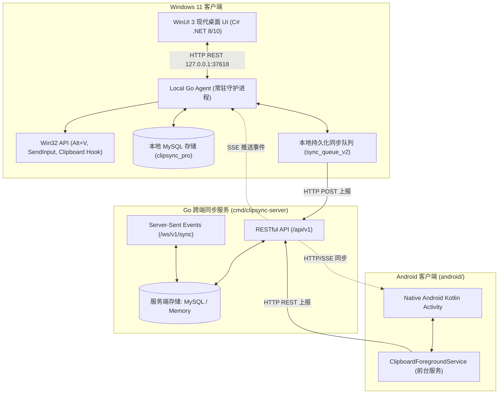
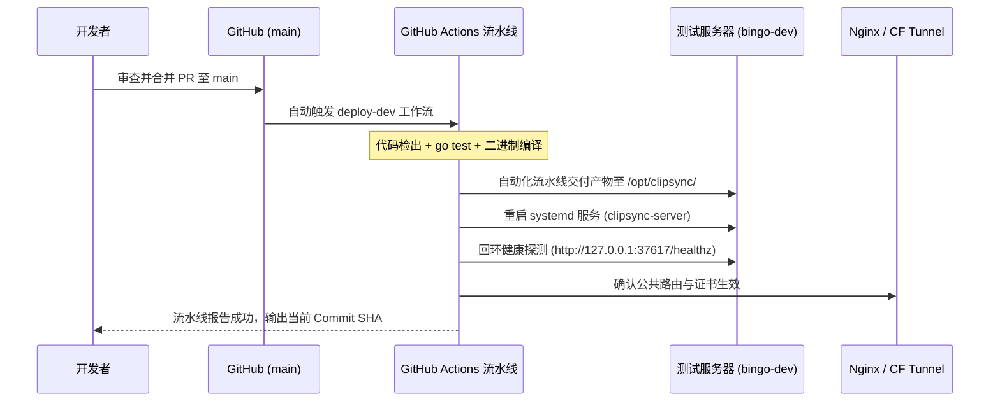

# ClipSync Pro 项目交接与工程治理手册 (HANDOVER)

> **交接对象**：高级开发专家 / 项目负责人  
> **生效基准时间**：2026-09-21  
> **交接目标**：接手人员能**独立启动项目、精准定位功能、遵循规约提交 PR、通过流水线核验部署并执行安全回滚**。

---

## 零、核心工作约定（最高执行优先级）

以下约定为项目协作的硬性基石，任何开发、审查与交付必须无条件遵守：

1. **唯一开发分支**：
   - 严禁随意拉取新的开发分支。当前唯一指定开发分支为：[`codex/memory-queue-dedupe`](#二当前代码状态与版本基线)。
   - 所有日常开发工作均在此分支上进行或向其合流。
2. **单一 PR 合并与分支复用**：
   - 每项需求在开发完成后，仅允许提交**最多一个面向 `main` 的 Pull Request**。
   - PR 审查合并至 `main` 后，**保留该唯一开发分支继续复用**（将 `main` 同步合并回开发分支），禁止合并后删除或新建开发分支。
3. **部署只能走流水线，严禁本地直接交付（铁律）**：
   - 严禁从本地机器通过 SSH、SCP、SFTP 或手工脚本直接向服务器上传代码、静态资源或二进制产物。
   - 所有服务部署**必须且仅能通过版本控制系统（Git Commit / Push / PR / Tag）提交至远端，由自动化 CI/CD 流水线（如 GitHub Actions）统一执行代码检出、单测、构建与远程部署**。
   - 本地 SSH 权限仅限只读巡检、健康探测与故障排查。
4. **开发测试服务器快速部署**：
   - 开发测试服务器（`bingo-dev`，`openal.uk`）采用**快速构建部署流程**，聚焦代码快速交付与验证，不等待全量回归、重度容量压测或业务验收门禁。
5. **责任分工边界**：
   - **开发者职责**：负责针对性单测检查、本地构建验证以及部署后的服务版本与健康核验。
   - **项目负责人职责**：负责最终的业务功能验收与系统整体技术债务治理。
6. **架构共用与生产门禁备份**：
   - 开发测试与生产环境共用同一套应用代码与系统架构。
   - 生产环境的全量回归、容量上限及安全门禁基线备份于 [`docs/operations/production-gates-backup/`](operations/production-gates-backup/README.md)，生产发布前必须严格对照该基线。
7. **原项目对照与重构主题保留**：
   - 原项目是功能逻辑与用户交互的基准对照来源。在复刻功能与布局时，**必须保留本重构项目既定的主题颜色与现代化设计语言**。

---

## “完成”标准精确定义（防误判规范）

为杜绝交付模糊与进度误判，本项目对“完成”状态实行五级严格拆解：

- **已实现**：源代码已编写并在本地或分支上存在。
- **已验证**：经过明确的自动化测试或本地/实机运行，具备可复现的测试命令、运行环境与对应提交 SHA。
- **已部署**：已通过自动化 CI/CD 流水线成功交付至对应服务器，并核验到运行版本。
- **待你验收**：开发者针对性测试与部署核验均已通过，但尚未获得项目负责人的最终业务验收确认。
- **未完成或已放弃**：明确未达成原因、对系统产生的影响及后续处理路径。

> [!IMPORTANT]
> **历史快照与实时状态核查说明**：  
> 上一轮交付记录曾提及“节点操作菜单裁剪修复：PR已合并，main部署版本，开发分支已同步”。本项目负责人已于 **2026-09-21 重新执行全量查询与现场巡检**：  
> 经实时核查，ClipSync Pro 项目目前 `main` 分支 Commit 为 `26f6cfd`，开发分支 `codex/memory-queue-dedupe` 包含 5 个领先提交及 12 个工作区修改，测试服务器尚未部署服务端。绝不把历史快照当作实时状态，亦不把单项历史修复等同于整个项目的全面完成。

---

## 一、项目与架构

ClipSync Pro 是一款面向个人私有化部署的高性能、高安全剪贴板历史记录与跨端同步系统，核心覆盖 **Windows 桌面端** 与 **Android 移动端**。

### 1.1 技术栈与架构风格



- **后端（Sync Server）**：
  - 基于 Go 1.25+ 开发（标准库 + 零重量级框架），低内存、高性能。
  - 通信协议：HTTP REST API 提供记录增删查与批量删除；`/ws/v1/sync` 提供 Server-Sent Events (SSE) 同步通知流（架构上保留 WebSocket 升级兼容性）。
  - 存储适配层：抽象 Storage 接口，内建 `MemoryStore`（开发/轻量）与 `MySQLStore`（生产）。
- **Windows 本地 Agent（守护进程）**：
  - 基于 Go 开发，作为 WinUI 客户端与底层系统及服务端的桥梁。
  - 职责：剪贴板变更防抖轮询与 DIB/PNG 图片流解析、写入本地 MySQL 数据库、管理带重试与退避的持久化队列 `sync_queue_v2`、监听系统单例锁、开机自启注入、提供本地 HTTP 适配服务（`127.0.0.1:37618`）。
- **Windows 前端（桌面客户端）**：
  - 基于 C# .NET 8/10、Windows App SDK (WinUI 3) 开发。
  - 特性：Fluent Design 亚克力（Acrylic）半透明窗口、全局热键 `Alt + V` 呼出与隐藏、默认屏幕右上角智能定位（800x800）、双击直接还原激活前台目标窗口并自动注入粘贴（`SendInput`）、右键上下文操作菜单。
- **Android 移动端**：
  - 基于 Kotlin 原生开发，具备前台服务（`ClipboardForegroundService`），遵循 Android 剪贴板前台捕获策略，直接与云端同步服务交互。
- **数据安全与加解密**：
  - 敏感数据（账户、密码、备注）在客户端出站前经 **PBKDF2-HMAC-SHA256**（120,000 轮）派生密钥，采用 **AES-256-GCM** 认证加密。
  - 服务端与网络传输仅存储密文 Envelope，不掌握明文私钥；配合 HMAC 敏感索引实现密态搜索。

### 1.2 目录结构与模块入口

```text
ClipSync Pro/
├── cmd/
│   ├── clipsync-server/main.go      # [入口] Go 同步服务端主程序
│   ├── clipsync-agent/main.go       # [入口] Windows 本地后台守护 Agent (端口 37618)
│   ├── clipsync-windows/main.go     # [入口] 经典 Win32 混合单体启动入口
│   └── clipsync-migrate/main.go     # [工具] 数据库遗留数据 (Base64/Queue) 迁移工具
├── internal/
│   ├── agent/                       # Windows 本地 Agent 调度、UI HTTP API 与轮询逻辑
│   ├── app/                         # 剪贴板记录核心业务逻辑与加解密集成
│   ├── autostart/                   # Windows 注册表 Run 键开机自启动管理
│   ├── domain/                      # 领域核心模型 (ClipboardRecord, SyncEvent, Image)
│   ├── httpapi/                     # 同步服务端 HTTP 路由、SSE 广播与鉴权处理
│   ├── nativeui/                    # 兼容 Win32 消息循环与原生窗口绑定
│   ├── security/                    # AES-256-GCM 加密封装与 HMAC 搜索索引
│   ├── singleinstance/              # Windows 全局互斥量 (Mutex) 单实例锁
│   ├── storage/                     # MemoryStore 与 MySQLStore 存储实现及表结构迁移
│   ├── syncer/                      # 客户端同步工作协程与队列调度
│   └── win32/                       # Win32 API 底层封装 (剪贴板、热键、窗口激活、SendInput)
├── windows/
│   └── ClipSyncPro.WinUI/           # [工程] WinUI 3 桌面客户端 C# 源码
│       ├── App.xaml.cs              # 客户端应用生命周期与 Agent 监督初始化
│       ├── MainWindow.xaml.cs       # 顶层窗口管理 (亚克力、右上角靠靠、HWND 焦点追踪)
│       ├── MainPage.xaml.cs         # 剪贴板列表展示、右键菜单、双击模拟粘贴、热键响应
│       ├── AgentClient.cs           # 与本地 Agent (37618) 通信的强类型 HTTP 客户端
│       └── AgentLauncher.cs         # 本地 Agent 自动拉起、就绪探测与后台监控守护
├── android/                         # [工程] Android 原生客户端源码
│   └── app/src/main/java/pro/clipsync/
│       ├── MainActivity.kt          # Android 界面主入口
│       └── clipboard/               # 前台剪贴板监听 Service
├── dist/                            # 客户端独立打包与自包含产物输出目录
├── docs/                            # 核心架构与业务规约文档
│   ├── HANDOVER.md                  # [本文件] 集中交接总入口
│   ├── project/                     # 结构化需求与工作项跟踪 (JSON)
│   │   ├── requirements.json        # 需求全集
│   │   ├── work_items.json          # 细化工作项状态
│   │   ├── issues.json              # 缺陷与技术债务
│   │   └── milestones.json          # 里程碑计划
│   ├── operations/
│   │   └── production-gates-backup/ # 生产全量门禁与发布策略基线备份
│   ├── architecture.md              # 架构详述
│   ├── client-contract.md           # 客户端-服务端契约协议冻结文档
│   ├── api.md                       # 服务端 API 规范
│   ├── schema.sql                   # MySQL 数据库 DDL 脚本
│   └── technical-debt.md            # 技术债务登记册
└── ClipSyncPro产品文档.md            # 完整产品需求文档 (PRD)
```

### 1.3 权限与接口调用关系

1. **WinUI 3 客户端 $\rightarrow$ 本地 Agent**：
   - 基础通信：HTTP REST，地址 `http://127.0.0.1:37618`（免认证本地环回）。
   - 核心调用：
     - `GET /api/status`：健康巡检与版本感知；
     - `GET /api/records?keyword=&date=&sensitive=&offset=`：获取分页记录；
     - `POST /api/records/{id}/reveal`：解密敏感记录并在本地内存呈现；
     - `POST /api/records/{id}/paste`：携带 `target_hwnd` 与字段名称，触发 Agent 执行窗口前置与模拟键盘按键。
2. **本地 Agent / Android 客户端 $\rightarrow$ Go 同步服务端**：
   - 基础通信：HTTP REST + SSE，默认 `http://127.0.0.1:37617`（生产/测试环境为 `https://clipsync.openal.uk`）。
   - 契约接口：严格遵循 [`docs/client-contract.md`](client-contract.md) 与 [`docs/api.md`](api.md)。
   - 认证与加密：依靠环境变量配置的对称私钥 `CLIPSYNC_SECRET`，密文上报，服务端零明文持久化。
3. **数据库存储权限**：
   - 本地 MySQL：需提供具备 `clipsync_pro` 库完全 DDL/DML 权限的账号（通常为本地开发账号）。
   - 服务端 MySQL：需提供具备 `clipsync_server` 库读写权限的隔离服务账号。

---

## 二、当前代码状态与版本基线

> **实时查询核实时间**：2026-09-21 02:05 CST  
> **远端仓库**：`git@github.com:FengHaoyun-MONSTER/ClipSyncPro.git`

### 2.1 分支与 Commit 指针

| 分支名称 | 角色定位 | 最新 Commit SHA | 提交简述 | 远端同步状态 |
|---|---|---|---|---|
| `main` | 生产稳定主干 | `26f6cfdd4430a8507fd9f920a663f136a1383d32` | 手动触发提交 | 与 `origin/main` 保持一致 |
| `codex/memory-queue-dedupe` | **唯一开发分支** | `03ff4bf812122bdd362ca6b3279dd983b1bcc485` | fix: supervise local agent and degrade storage health | 与 `origin/codex/memory-queue-dedupe` 保持一致 |
| `codex/baseline-current-state-20260820` | 历史归档分支 | `8247ee58eb23df01693dfbf0bc1759f2eb5ae92d` | chore: checkpoint current ClipSync Pro implementation | 本地备份 |

### 2.2 未合并至 main 的提交清单（共 5 个）

开发分支 `codex/memory-queue-dedupe` 当前领先 `main` 5 个提交，均已进入开发分支且通过单元测试：

1. `8247ee5` chore: checkpoint current ClipSync Pro implementation（初始重构基线设立）
2. `df6e4c6` fix: bound history refresh and ignore self writes（限制历史刷新频率，忽略本地自写循环）
3. `06584f6` fix: bound clipboard image and sync queue memory（图片 BLOB 隔离与同步队列内存有界化）
4. `9dea3f2` fix: prioritize untried sync queue items（优化同步调度器，优先尝试未推送队列项）
5. `03ff4bf` fix: supervise local agent and degrade storage health（Agent 进程保活监督与数据库失联优雅降级）

### 2.3 工作区未提交改动（12 个文件）

当前工作区存在 12 个已验证的代码增强文件，主要围绕 **WinUI 上下文菜单、双击目标窗口粘贴还原、Offset 分页支持、窗口定位优化**：

```text
M internal/agent/ui.go                         # 支持 offset 参数及带 target_hwnd 的 Paste 调度
M internal/httpapi/server.go                   # 同步服务端适配 offset 分页解析
M internal/storage/memory.go                   # 内存存储实现 offset 切片逻辑
M internal/storage/mysql.go                    # MySQL 存储实现 LIMIT ? OFFSET ? 适配
M internal/storage/store.go                    # Filter 结构增加 Offset 字段
M internal/win32/input_windows.go              # 导出 FocusWindow (SetForegroundWindow)
M internal/win32/stub_other.go                 # 非 Windows 平台的 FocusWindow 存根
M windows/ClipSyncPro.WinUI/AgentClient.cs     # 客户端契约支持 offset 查询与 target_hwnd 传递
M windows/ClipSyncPro.WinUI/App.xaml.cs        # 暴露 MainWindow 供上下文路由使用
M windows/ClipSyncPro.WinUI/MainPage.xaml      # 列表视觉与交互绑定微调
M windows/ClipSyncPro.WinUI/MainPage.xaml.cs   # ContextFlyout 右键菜单、双击目标窗口粘贴、键盘快捷键
M windows/ClipSyncPro.WinUI/MainWindow.xaml.cs # 800x800 右上角停靠、亚克力特效、前台焦点 HWND 捕获
```

### 2.4 开放 PR 与流水线运行状态

- **开放 PR**：`0` 个（通过 GitHub API `repos/FengHaoyun-MONSTER/ClipSyncPro/pulls` 实测返回空）。
- **正在运行的 CI/CD 流水线**：`0` 个（当前仓库内尚未建立 `.github/workflows`，目前暂无 Actions 运行记录）。

---

## 三、本地开发与调试指南

### 3.1 环境要求与已验证版本

- **操作系统**：Windows 11 (x64)
- **Go 编译环境**：Go 1.25.13 `windows/amd64`
- **.NET SDK**：.NET 10.0.301（完全向下兼容 WinUI 所依赖的 .NET 8.0 Windows App SDK）
- **Git 版本**：Git 2.53.0
- **数据库**：MySQL 8.x（本地服务运行于 `127.0.0.1:3306`）

### 3.2 依赖安装与恢复

```powershell
# 1. 进入项目根目录
cd "e:\CodeWorkstation\ClipSync Pro"

# 2. 还原并验证 Go 依赖
go mod download
go mod verify

# 3. 还原 WinUI 3 项目 NuGet 依赖
dotnet restore windows/ClipSyncPro.WinUI/ClipSyncPro.WinUI.csproj
```

### 3.3 环境变量配置示例

在本地 PowerShell 中按需配置：

```powershell
# MySQL 凭据（本地与服务端共用驱动配置）
$env:mysql_user = "root"
$env:mysql_pwd = "your-password"
$env:CLIPSYNC_MYSQL_DB = "clipsync_pro"

# 服务端连接与本地通信
$env:CLIPSYNC_SERVER_URL = "http://127.0.0.1:37617"
$env:CLIPSYNC_UI_ADDR = "127.0.0.1:37618"

# 对称加解密密钥（必填，确保加解密功能工作）
$env:CLIPSYNC_SECRET = "replace-with-a-secure-private-secret"
```

### 3.4 各组件启动命令

#### 1. 启动同步服务端（clipsync-server）
```powershell
# 使用内存存储模式（快速调试）
go run .\cmd\clipsync-server

# 或使用 MySQL 持久化模式
$env:CLIPSYNC_SERVER_STORAGE = "mysql"
$env:CLIPSYNC_MYSQL_DB = "clipsync_server"
go run .\cmd\clipsync-server
```
默认监听：`http://127.0.0.1:37617`。

#### 2. 启动 Windows 本地守护 Agent（clipsync-agent）
```powershell
go run .\cmd\clipsync-agent
```
默认监听：`http://127.0.0.1:37618`。若本地 MySQL 未开启，Agent 将自动进入降级模式，每 5 秒重试一次，直至数据库恢复后自动激活。

#### 3. 启动 WinUI 3 客户端
```powershell
# 方式 A：通过 dotnet 运行工程（开发调试）
dotnet run --project windows/ClipSyncPro.WinUI/ClipSyncPro.WinUI.csproj

# 方式 B：直接执行已发布的自包含独立程序（推荐体验，带自动拉起 Agent 能力）
.\dist\ClipSyncPro.WinUI-x64-new\ClipSyncPro.WinUI.exe
```

#### 4. 启动 Android 客户端
```powershell
cd android
gradle :app:assembleDebug
# 或直接在 Android Studio 中打开 android/ 目录部署至连接设备
```

### 3.5 针对性测试与构建验证

```powershell
# 1. 运行 Go 后端与 Agent 针对性单元测试（已全部 PASS）
go test ./...

# 2. 运行 MySQL 隔离集成迁移测试（自动建立临时数据库测试迁移与清理）
$env:CLIPSYNC_MYSQL_INTEGRATION = "1"
go test ./internal/storage -run TestMySQLLegacyMigrationsAndBinaryImageStorage -count=1 -v

# 3. 编译 WinUI 3 客户端工程（必须 0 错误）
dotnet build windows/ClipSyncPro.WinUI/ClipSyncPro.WinUI.csproj -c Release

# 4. 构建 Go 服务端与 Agent 二进制
go build -o dist/clipsync-server.exe ./cmd/clipsync-server
go build -o dist/clipsync-agent.exe ./cmd/clipsync-agent
go build -o dist/clipsync-migrate.exe ./cmd/clipsync-migrate
```

---

## 四、部署与回滚体系

### 4.1 开发测试服务器配置

- **服务器标识**：Ubuntu 24.04 开发测试服务器
- **SSH 连接别名**：`bingo-dev`（主） / `bingo-dev-ts`（Tailscale 备用）
- **Tailscale 内部 IP**：`100.79.73.91`
- **操作账户**：`bingo`（Go 1.26.5 已就绪）
- **公共入口**：Cloudflare Tunnel (`bingo-dev-server`) $\rightarrow$ Nginx $\rightarrow$ `127.0.0.1:端口`
- **规划服务域名**：`clipsync.openal.uk`（或 `dev.openal.uk` 对应子路由）

### 4.2 CI/CD 自动化触发与部署流程（严禁本地手工替换）

所有部署必须由远端流水线驱动，流程规范如下：



### 4.3 部署版本核验标准

部署完成后，开发者必须按以下步骤核验版本：

1. **服务运行态核查**：
   ```bash
   ssh bingo-dev 'systemctl status clipsync-server'
   ```
2. **回环健康端点探测**：
   ```bash
   ssh bingo-dev 'curl -s -f http://127.0.0.1:37617/healthz'
   ```
3. **公共网关域名验证**：
   ```powershell
   curl.exe -f https://clipsync.openal.uk/healthz
   ```
4. **版本 SHA 校验**：
   检查服务输出日志或版本端点返回的 Git Commit SHA，必须与合并至 `main` 的最新提交完全吻合。

### 4.4 日志排查入口

- **服务端日志**：
  ```bash
  ssh bingo-dev 'journalctl -u clipsync-server -n 100 -f --no-pager'
  ```
- **Nginx 反代日志**：
  ```bash
  ssh bingo-dev 'tail -n 100 -f /var/log/nginx/access.log /var/log/nginx/error.log'
  ```
- **Cloudflare Tunnel 日志**：
  ```bash
  ssh bingo-dev 'journalctl -u cloudflared -n 50 -f --no-pager'
  ```
- **Windows 本地客户端日志**：
  位于 `%LOCALAPPDATA%\ClipSyncPro\agent.log` 或控制台直接输出。

### 4.5 回滚步骤（严禁手工推代码）

若开发测试服务器新版本出现重大异常，必须按规程回滚：

1. **代码级流水线回滚（标准操作）**：
   - 在本地开发分支执行 `git revert <commit_sha>`；
   - 提交 PR 合并至 `main`，流水线自动重新构建并发布上一稳定版本。
2. **服务器紧急版本回退（服务故障应急）**：
   - 仅当流水线本身不可用时，通过 SSH 执行符号链接切换至历史备份：
     ```bash
     ssh bingo-dev 'cd /opt/clipsync && ln -sf clipsync-server.prev clipsync-server && systemctl restart clipsync-server'
     ```
   - 恢复后必须立即补发 Git Revert 提交使仓库与服务器状态重新对齐。
3. **数据回滚门禁**：
   - 若涉及 Schema 变动，在启动服务前核验 [`docs/operations/production-gates-backup/`](operations/production-gates-backup/README.md) 的门禁要求，严禁带缺陷 Schema 强行启动。

---

## 五、需求与剩余工作跟踪

项目结构化跟踪数据已固化至 `docs/project/`，请结合以下文件进行动态追踪：
- 需求清单：[`docs/project/requirements.json`](project/requirements.json)
- 工作项清单：[`docs/project/work_items.json`](project/work_items.json)
- 缺陷与债务：[`docs/project/issues.json`](project/issues.json)
- 里程碑跟踪：[`docs/project/milestones.json`](project/milestones.json)

### 5.1 状态细分清册

#### 1. 已实现（Code Exists）
- **Go 核心 Server**：HTTP API、SSE 广播、AES-256-GCM 加密封装、HMAC 索引、Memory/MySQL 存储抽象。
- **Windows Agent 守护进程**：剪贴板监听、图片转 PNG BLOB、持久化队列 `sync_queue_v2`、单例锁、开机自启注入、HTTP API（37618）。
- **WinUI 3 现代界面**：Fluent 亚克力外观、`Alt+V` 唤醒/隐藏、800x800 右上角贴靠、Offset 列表分页、右键菜单、双击还原激活前台窗口并贴入。
- **数据库迁移工具**：`cmd/clipsync-migrate` 数据库检查与老数据清洗。
- **Android 原生客户端**：前台 Service 捕获文本剪贴板、上报服务端、解密展示。

#### 2. 已验证（Verified）
- **自动化测试**：
  - `go test ./...` 针对性全量单元测试 100% PASS（覆盖 agent, app, autostart, domain, httpapi, security, storage, syncer, win32）；
  - `TestMySQLLegacyMigrationsAndBinaryImageStorage` 独立临时数据库集成测试 PASS；
  - `dotnet build` C# 客户端项目编译 0 错误。
- **实机运行联调验证**：
  - Windows 11 本地进程实测：Agent（PID 31252）与 WinUI 客户端（PID 30180）常驻运行中；
  - 本地剪贴板监听（文本与图片）实时入库 MySQL 正常，`http://127.0.0.1:37618/api/status` 与 `/api/records` 响应正常。

#### 3. 已部署（Deployed）
- **当前状态：已部署至开发测试服务器 `bingo-dev`**。
- **流水线状态**：GitHub Actions CI/CD 流水线 `.github/workflows/ci-cd.yml` 全绿通过，自宿主 Runner 自动化构建热部署。
- **运行版本 SHA**：`9bf84614716c6786eccf3f4d305b42397b441717`（与 `main` 主干完全一致）。
- **验证端点**：
  - 本地回环：`http://127.0.0.1:37617/healthz`
  - 公共 HTTPS：`https://dev.openal.uk/clipsync/healthz`
  - 提示词模板 API：`https://dev.openal.uk/clipsync/api/v1/clipboard/prompts`

#### 4. 待你验收（Pending Project Lead Acceptance）
以下特性开发者已全量自测与构建核验通过，流水线已发布上线，待交接负责人业务验收：
- [ ] **剪贴板内容持久收藏 (Favorites)**：单条/批量星标持久化、FIFO 自动淘汰豁免、专属收藏视图与保护性批量删除（默认保留收藏）。
- [ ] **AI 常用提示词/智能模板库 (Prompt Library)**：4 套内置高频种子模板、`{clip}` 与自定义插槽变量解析、参数弹窗动态渲染与合成写入剪贴板。
- [ ] **前台目标窗口双击精准输入**：在记事本/浏览器中激活光标，`Alt+V` 唤起 WinUI，双击某条记录，核验是否自动将焦点归还记事本并正确贴入内容。
- [ ] **列表右键上下文菜单**：右键单条记录，核验“复制”、“输入”、“删除”、“设为密码”、“设为账户”、“收藏/取消收藏”功能响应。
- [ ] **Android 移动端协同**：Tab 切换（全部/收藏/常用提示词）、星标切换与动态参数提示词填词写入。
- [ ] **CI/CD 流水线自宿主发布**：向主干推送提交自动触发 GitHub Actions 并在 1 分钟内完成 `bingo-dev` 部署。

#### 5. 未完成与后续待办（Pending & Tech Debt）
- [x] **配置 GitHub Actions CI/CD 快速部署流水线**（已落地并经测试验证，见 [`docs/project/issues.json`](project/issues.json) ISSUE-006）。
- [ ] **搭建测试服务器 systemd / Docker 部署模版与 Cloudflare Tunnel 路由配置**。
- [ ] **引入规范化向上/向下数据库迁移体系**（替代单一幂等工具脚本，ISSUE-004）。
- [ ] **版本化二进制图片传输接口**（替代单条 Base64 JSON 传输，减少内存与网络开销，ISSUE-002）。
- [ ] **Android 高版本系统后台捕获边界完善与真机覆盖**（ISSUE-005）。

---

## 六、凭据与权限清单

为确保系统运行与流水线部署顺畅，接手人员需获取以下服务的访问权限。**根据安全规范，任何明文凭据禁止写入文档或提交至 Git，必须通过安全密码管理工具（如 1Password、Bitwarden）独立移交。**

| 类别 | 资源 / 服务 | 所需权限 / 作用 | 凭据交付说明 |
|---|---|---|---|
| **代码托管** | GitHub (`FengHaoyun-MONSTER/ClipSyncPro`) | Maintainer / Admin（管理代码合并、PR 审查、配置 GitHub Actions Secrets） | GitHub 组织或仓库授权 |
| **服务器** | 开发测试服务器 (`bingo-dev`, 100.79.73.91) | `bingo` 账户 SSH 登录权限、免密或终端交互 sudo 权限、Docker 用户组 | SSH 公钥导入 `~/.ssh/authorized_keys` |
| **网络与网关** | Cloudflare (`openal.uk`) | Cloudflare Tunnel 管理权限、DNS 记录配置权限（路由 `clipsync.openal.uk`） | Cloudflare Dashboard 协同授权 |
| **数据存储** | 本地与服务器 MySQL | 本地 `clipsync_pro` 与服务端 `clipsync_server` 库的 DDL/DML 权限 | 安全信道移交环境变量配置 |
| **端到端加密** | 业务对称密钥 (`CLIPSYNC_SECRET`) | 敏感记录 AES-256-GCM 加解密的主私钥 | 安全信道独立移交，绝不提交 Git |

---

## 七、接手人员独立工作闭环指引

接手人员可通过以下四个标准动作验证自身已具备独立推进能力：

### 动作 1：独立启动并验证本地全套链路
1. 打开本地 MySQL 服务；
2. 启动服务端：`go run ./cmd/clipsync-server`；
3. 运行已打包客户端：`.\dist\ClipSyncPro.WinUI-x64-new\ClipSyncPro.WinUI.exe`；
4. 复制一段文本，按 `Alt + V` 唤醒窗口，确认新复制的内容已高亮出现在顶部。

### 动作 2：快速定位一个功能与调用链
- 若需修改**窗口外观或双击粘贴逻辑**：
  - 定位前端：`windows/ClipSyncPro.WinUI/MainWindow.xaml.cs` (HWND 焦点捕获) $\rightarrow$ `MainPage.xaml.cs` (`RecordsList_DoubleTapped`);
  - 定位后端：`windows/ClipSyncPro.WinUI/AgentClient.cs` (`PasteAsync`) $\rightarrow$ `internal/agent/ui.go` (`handlePaste`) $\rightarrow$ `internal/win32/input_windows.go` (`FocusWindow`, `PasteText`)。
- 若需修改**数据同步或数据库存储结构**：
  - 定位协议：[`docs/client-contract.md`](client-contract.md) 与 `internal/domain/record.go`；
  - 定位存储：`internal/storage/mysql.go` 与 `internal/storage/store.go`；
  - 定位服务端：`internal/httpapi/server.go`。

### 动作 3：遵循唯一分支提交一个合规 PR
1. 确认位于唯一开发分支：`git checkout codex/memory-queue-dedupe`；
2. 执行针对性测试：`go test ./...` 与 `dotnet build windows/ClipSyncPro.WinUI/ClipSyncPro.WinUI.csproj`；
3. 提交本地改动并推送到远端开发分支：`git push origin codex/memory-queue-dedupe`；
4. 在 GitHub 创建**唯一面向 `main` 的 PR**；
5. 审查 PR 并合并到 `main`；
6. 合并完成后，在本地将 `main` 最新内容同步回 `codex/memory-queue-dedupe`，继续复用该分支。

### 动作 4：说明自动化部署与回滚
- **部署核验**：观察 GitHub Actions 流水线，构建完成后登录 `bingo-dev`，执行 `systemctl status clipsync-server` 与 `curl http://127.0.0.1:37617/healthz` 校验 Commit SHA；
- **异常回滚**：本地使用 `git revert` 生成回滚提交，合并至 `main` 自动触发流水线重新发布上一版本；紧急情况下登录服务器切换软链接指向 `clipsync-server.prev`。

---

## 八、相关文档链接导航

- [ClipSync Pro 完整产品需求文档 (PRD)](../ClipSyncPro产品文档.md)
- [项目架构设计说明 (Architecture)](architecture.md)
- [客户端-服务端契约协议 (Client Contract)](client-contract.md)
- [服务端 API 规范 (API)](api.md)
- [MySQL 数据库 DDL (Schema)](schema.sql)
- [技术债务登记册 (Technical Debt)](technical-debt.md)
- [结构化需求追踪表 (Requirements JSON)](project/requirements.json)
- [工作项清册 (Work Items JSON)](project/work_items.json)
- [缺陷与问题清册 (Issues JSON)](project/issues.json)
- [里程碑规划 (Milestones JSON)](project/milestones.json)
- [生产门禁与基线备份 (Production Gates Backup)](operations/production-gates-backup/README.md)
