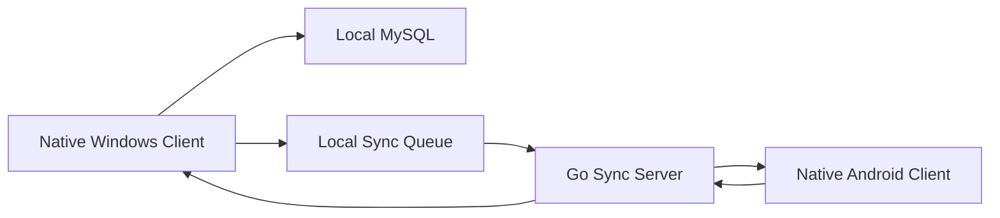

# ClipSync Pro Architecture

## Goals

ClipSync Pro is designed as a private, single-user cross-device clipboard system. The product records Windows clipboard activity locally, syncs records through a server, accepts Android uploads, supports search and date filters, and protects account/password records with authenticated encryption.

## Architecture Style

The system uses a local-first architecture for Windows and a server-first architecture for Android.

## Runtime Components

- Windows client: Win32 native window, clipboard listener, local storage writer, hotkey handler, copy/paste integration, sync queue worker.
- Sync server: versioned HTTP APIs, event stream, conflict resolution, server-side storage.
- Android client: Kotlin native Activity, foreground clipboard capture, optional accessibility/input-method capture, server upload, in-memory display.
- Shared domain contract: record schema, encrypted field envelope, sync event schema.

## Deployment Assumptions

- Private deployment, single user.
- No registration or login in MVP.
- Windows local database is MySQL provided by the user.
- Server may use MySQL in production; the current runnable MVP uses an in-memory store by default and keeps the storage boundary ready for MySQL.
- Sensitive fields are encrypted on the client before storage or upload.

## Security Model

- Sensitive fields use AES-256-GCM.
- Key material comes from `CLIPSYNC_SECRET` in private deployment.
- Each encrypted field stores algorithm, KDF, iteration count, salt, nonce, and ciphertext.
- Server stores ciphertext only for sensitive fields.
- Logs must not contain clipboard text, account, password, remark, key, or token values.

## Sync Model

Windows writes records locally first, then appends a durable sync queue item. The sync worker pushes queue items to the server and marks items complete only after the server returns success. Server events are streamed to Windows through `/ws/v1/sync` using Server-Sent Events in the MVP; the protocol remains compatible with a future WebSocket upgrade.

Conflict handling:

- New records are keyed by `record_id`.
- Delete wins over update.
- Sensitive-field updates replace the sensitive set as one unit.
- Server timestamp decides last-write-wins for non-delete updates.
